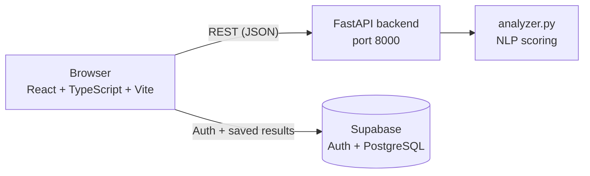

# InterviewAI

A full-stack mock interview practice app. You pick an interview track, answer questions in a text box, and get a score breakdown and written feedback for each answer. Answers are scored with pre-trained NLP models (SBERT and DistilBERT) plus rule-based checks, behind a FastAPI backend with a React + TypeScript frontend. Accounts and saved results use Supabase.

## Features

- **Question bank of 250 questions** across Technical, Behavioral and HR categories. Each question has expected keywords and a target answer length.
- **Five interview tracks:** Software Engineering Basics, Behavioral Excellence, HR & Culture Fit, Full Stack Developer, Data Science & ML.
- **Four scores per answer plus an overall score:** semantic relevance, sentiment, keyword match and clarity, each on a 0–100 scale.
- **Written feedback** generated from score thresholds, including which expected keywords were missing.
- **Results page** with an overall gauge, per-metric gauges and an expandable breakdown for each question.
- **Email/password sign-up and login** (Supabase Auth), with session results saved per user.
- **Audio answers in the analysis module:** `analyzer.py` can transcribe a recording and score speaking pace and filler words (see [Audio mode](#audio-mode)).

## Architecture



- **Frontend** (`frontend/`): React 18, TypeScript, Vite, Tailwind CSS, React Router v6, Axios. Auth state is kept in a React Context.
- **Backend** (`backend/app.py`): FastAPI served by Uvicorn. It serves questions and runs the analysis. CORS is configured for the Vite dev server (`localhost:5173`).
- **Analyzer** (`analyzer.py`): loads the models and question bank once at startup, so each request only runs inference.
- **Supabase:** email/password auth and a PostgreSQL database with two tables, `interview_sessions` (session metadata and overall score) and `interview_results` (per-question scores, feedback and matched keywords). Row Level Security restricts users to their own rows.

### User flow

Landing page → sign up / log in → dashboard (choose a track) → answer the questions one by one → submit → all answers are sent to `/analyze-session` → results page. Answers are analysed together when the session is submitted, not while you type.

## How scoring works

Each answer is scored on four dimensions, each between 0 and 1, then combined into an overall score out of 100.

| Score | How it is computed |
|---|---|
| **Semantic relevance** | Cosine similarity between SBERT embeddings (`all-MiniLM-L6-v2`) of the question and the answer, clamped to [0, 1]. |
| **Sentiment** | `distilbert-base-uncased-finetuned-sst-2-english` is run on the first 512 characters of the answer. A `POSITIVE` label uses the model's confidence directly; `NEGATIVE` uses 1 − confidence. This is a rough tone indicator from a general-purpose sentiment model, not a trained measure of interview confidence. |
| **Keyword match** | Fraction of the question's expected keywords found in the answer, by lowercase substring match or by the lemmatised form (NLTK `WordNetLemmatizer`). |
| **Clarity** | Weighted mix of three parts: length against the question's min/max word targets (40%); structure from average sentence length, where 10–25 words per sentence scores highest (30%); and filler words, matched as whole words: *um, uh, like, basically, you know, kind of, sort of, actually, literally* (30%). |

**Overall score** is a weighted sum of the four scores, multiplied by 100. The weights are fixed values stored in `weights.pkl`:

| Mode | Semantic | Sentiment | Keyword | Clarity | Delivery |
|---|---|---|---|---|---|
| Text | 0.40 | 0.20 | 0.25 | 0.15 | n/a |
| Audio | 0.35 | 0.15 | 0.20 | 0.10 | 0.20 |

**Feedback** is rule-based. For example, it flags answers with low semantic relevance, an uncertain tone, missing keywords, or a length outside the target range.

### Audio mode

`analyze_answer()` in `analyzer.py` accepts a base64-encoded recording. It transcribes it with Google Speech Recognition (the `speech_recognition` library, which needs an internet connection), then adds a **delivery** score: 50% speaking pace (100–150 words per minute is the target) and 50% filler-word ratio. Formats other than WAV are converted with `pydub`, which needs `ffmpeg` installed.

## API

| Endpoint | Description |
|---|---|
| `GET /` | Health check. Returns `{ status, questions_loaded }`. |
| `GET /questions?category=<str>&count=<int>` | Random questions, optionally filtered by category. |
| `POST /analyze` | Analyse one answer. |
| `POST /analyze-session` | Analyse all answers in a session and return per-question results plus averaged `session_scores`. |

Example request for `POST /analyze`:

```json
{
  "question_id": 42,
  "answer_text": "Polymorphism allows objects to...",
  "input_mode": "text",
  "duration_seconds": 0
}
```

## Running locally

**Requirements:** Python 3.10+, Node.js 18+, a Supabase project.

1. **Supabase:** create a project, enable email/password auth, and run `supabase/schema.sql` in the SQL Editor. It creates the `interview_sessions` and `interview_results` tables with Row Level Security so users can only read and write their own rows.

2. **Backend**
   ```bash
   cd backend
   pip install -r requirements.txt
   uvicorn app:app --reload --port 8000
   ```
   On the first run the models (SBERT, DistilBERT) and NLTK data are downloaded automatically, so an internet connection is needed. If a `sbert_model/` folder exists in the project root it is used instead of downloading SBERT.

3. **Frontend**
   ```bash
   cd frontend
   npm install
   npm run dev
   ```
   Before starting the frontend, copy `frontend/.env.example` to `frontend/.env` and fill in your Supabase URL, your Supabase anon key and the backend URL (`http://localhost:8000`).

The app runs at http://localhost:5173 and the API at http://localhost:8000.

## Validation

`test_cases_750.json` holds **750 synthetic test answers**: for each of the 250 questions, one GOOD, one AVERAGE and one POOR answer. `evaluate.py` runs the analyzer on all of them and prints the overall score per quality level, and how often GOOD > AVERAGE > POOR holds for the same question.

```bash
python evaluate.py
```

| Answer quality | n | Mean | Median | Min | Max |
|---|---|---|---|---|---|
| GOOD | 250 | 43.0 | 40.1 | 8.4 | 80.7 |
| AVERAGE | 250 | 44.3 | 38.4 | 20.8 | 75.7 |
| POOR | 250 | 38.5 | 38.7 | 13.7 | 69.5 |

For the same question, GOOD > AVERAGE > POOR held in 62 of 250 cases (25%), and GOOD > POOR in 161 of 250 (64%).

**These results do not show that the scoring separates good from poor answers, and this test set is a weak test of that.** Every answer is a one-line fragment of at most 20 words, shorter than its question's minimum word target (typically 30). The 250 GOOD answers reuse only 8 distinct sentences, and on average contain about 12% of the question's expected keywords. A meaningful evaluation needs realistic full-length answers rated by humans, which this project does not yet have.

## Known limitations

- Scores are heuristic. They have not been compared against human ratings of real interview answers, and the bundled synthetic test set does not show a clear separation between GOOD, AVERAGE and POOR answers (see Validation).
- The sentiment model is a general-purpose one (SST-2), so tone is only a rough proxy.
- Keyword matching does not understand synonyms. Words like *like* and *actually* are counted as fillers even when used normally.
- Audio transcription depends on Google's online speech service.
- Runs locally only, with no deployment configuration.

## Project structure

```
├── analyzer.py            # NLP scoring engine (SBERT, DistilBERT, NLTK, audio helpers)
├── evaluate.py            # runs the analyzer on test_cases_750.json
├── question_bank.json     # 250 questions with keywords, categories, word-count targets
├── weights.pkl            # scoring weights for text and audio mode
├── test_cases_750.json    # 750 synthetic test answers (GOOD / AVERAGE / POOR)
├── backend/
│   ├── app.py             # FastAPI app: endpoints, CORS, request models
│   └── requirements.txt
├── supabase/
│   └── schema.sql         # tables and Row Level Security policies
└── frontend/
    ├── .env.example       # environment variable names (no real keys)
    └── src/
        ├── pages/         # Home, Login, Signup, Dashboard, Interview, Results
        ├── components/    # Navbar, AnswerInput, InterviewCard, ScoreGauge, LoadingSpinner
        ├── hooks/         # useAuth (Supabase session context)
        └── services/      # api.ts (Axios client), supabase.ts
```
